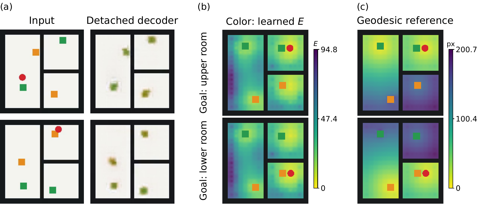
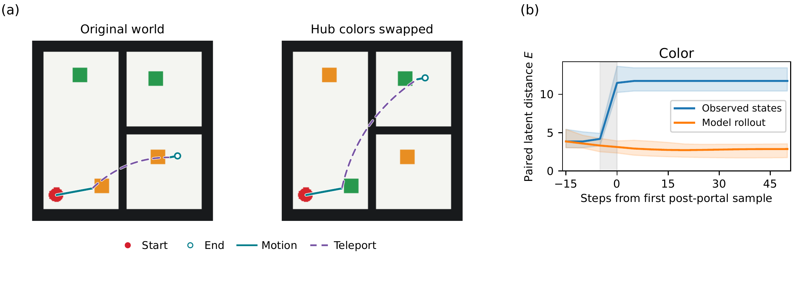
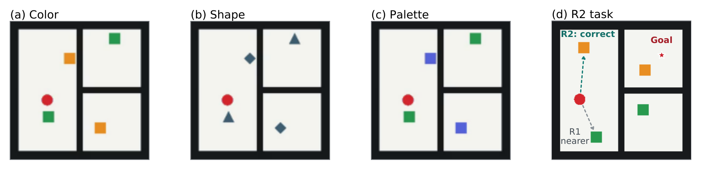

<div align="center">

# Tunnel Room: Probing What JEPA World Models Preserve

**Yash Dagade\***<sup>1</sup> &nbsp;&middot;&nbsp; **Taj Gillin**<sup>2</sup>

<sup>1</sup>Pantheon (`yash.dagade@duke.edu`) &nbsp;&nbsp; <sup>2</sup>Brown University (`taj_gillin@brown.edu`)  
<sub>\*Work done while Member of Technical Staff at Pantheon.</sub>

*NeurIPS 2026 Workshop: From Pretrained Representations to Acting Agents (PTA)*

[](https://yashdagade.github.io/jepa_features/)
[](docs/paper.pdf)
[](https://github.com/YashDagade/jepa_features)

</div>

---

## Overview

Joint-Embedding Predictive Architectures (JEPAs) learn representations that abstract away visual details unnecessary for prediction, yet visually small details can still determine the consequences of an action. **Tunnel Room** is a controlled navigation benchmark designed to separate knowing **where a tunnel is** from knowing **where it leads**—evaluating whether LeWorldModel (LeWM) preserves small decision-critical cues (color, shape, or palette) across coordinate probes, reconstructions, goal-energy landscapes, cue swaps, and planning.

Our code, environments, training recipes, and frozen evaluation results are publicly available at [`https://github.com/YashDagade/jepa_features`](https://github.com/YashDagade/jepa_features) so researchers can reproduce and extend our work.

## Key Results

### Table 1: Tunnel Location vs. Cue Identity Probes (Tunnel Room Color)

Linear / MLP coordinate probe MAE (pixels, $\downarrow$) and $R^2$ ($\uparrow$) on frozen LeWM representations (spatial $8 \times 8$ aggregation + IDM). **Top/Bottom** index tunnels by spatial position; **Green/Orange** index the exact same tunnels by color cue.

| Endpoint | Indexing | Central Room MAE $\downarrow$ | Central Room $R^2$ $\uparrow$ | Destination Rooms MAE $\downarrow$ | Destination Rooms $R^2$ $\uparrow$ |
| :--- | :--- | :---: | :---: | :---: | :---: |
| **Top** | Location | **4.63** / 6.14 | **.919** / .851 | **2.72** / 3.82 | **.960** / .925 |
| **Bottom** | Location | **5.14** / 6.34 | **.900** / .844 | **2.82** / 4.06 | **.958** / .919 |
| **Green** | Cue | 25.05 / 25.43 | .256 / .275 | 29.81 / 29.47 | .180 / .257 |
| **Orange** | Cue | 25.01 / 25.40 | .289 / .318 | 29.72 / 29.72 | .172 / .240 |

- Linear probes recover tunnel locations with mean **MAE 3.83 px ($R^2 = .934$)** vs. **27.40 px ($R^2 = .224$)** when indexed by color.
- Increasing probe capacity to a 2-hidden-layer MLP does not close the gap (**$R^2 = .885$** location vs. **$.273$** cue).

### Table 2: Cross-Variant Probes & Rank-Based Planning

| Variant | Location $R^2$ (Linear / MLP) $\uparrow$ | Cue $R^2$ (Linear / MLP) $\uparrow$ | CEM R1 / R2 (%) $\uparrow$ | GD R1 / R2 (%) $\uparrow$ |
| :--- | :---: | :---: | :---: | :---: |
| **Color** (green / orange) | **.934** / .885 | .224 / .273 | **80.0** / 16.0 | **64.0** / 52.0 |
| **Shape** (triangle / diamond) | **.907** / .857 | .203 / .261 | **88.0** / 24.0 | **76.0** / 40.0 |
| **Palette** (green / blue) | **.930** / .874 | .258 / .259 | **80.0** / 28.0 | **84.0** / 32.0 |

- On **R2** episodes (where the correct tunnel is farther away than the incorrect tunnel), CEM drops from **80.0% → 16.0%** on Color and enters the nearer, incorrect tunnel first in **88%** of cases (**52%** for GD).

---

## Visual Diagnostics

### Reconstructions & Goal-Energy Landscapes

<p align="center">
  
</p>
<p align="center">
  <sub><b>Figure 2: LeWM preserves tunnel geometry but weakens cue binding.</b> (a) Detached-decoder reconstructions retain room geometry and tunnel positions while collapsing green and orange markers toward their mean hue. (b–c) Switching the goal between leaf rooms (red dots) redirects the geodesic reference route, whereas LeWM assigns low energy near multiple tunnel endpoints for both goals.</sub>
</p>

### Controlled Cue-Swap Rollouts

<p align="center">
  
</p>
<p align="center">
  <sub><b>Figure 3: Predicted features separate too little after a cue swap.</b> Swapping hub colors while keeping tunnel locations and actions fixed sends agents to opposite leaf rooms. Encoded observations (blue) diverge sharply after teleportation, while open-loop LeWM rollouts (orange) strongly understate that separation.</sub>
</p>

### Tunnel Room Benchmark Setup

<p align="center">
  
</p>
<p align="center">
  <sub><b>Figure 1: Tunnel Room requires cue-guided navigation.</b> (a–c) Color, Shape, and Palette share the same hub-and-leaf room geometry while changing the visual cue that identifies paired tunnel endpoints; the red dot denotes the agent. (d) A rank-2 (R2) task where the correct tunnel is farther from the agent than the incorrect tunnel.</sub>
</p>

---

## Repository Structure

```text
jepa_features/
├── docs/                     # GitHub Pages project page (index.html), figure PNGs, and paper PDF
├── paper/NeurIPS Workshop/   # Camera-ready LaTeX source, 9 vector figure PDFs, and frozen result data
├── stable-worldmodel/        # Tunnel Room environments, world models, probes, decoders, and tests
├── sbatch_scripts/           # Slurm experiment launchers
├── datasets/                 # Dataset format docs and tracked manifests (HDF5 files excluded)
└── runs/                     # Local output directory (git-ignored)
```

## Getting Started

### Installation

Python 3.10+ is required. Install the research package in editable mode:

```bash
git clone https://github.com/YashDagade/jepa_features.git
cd jepa_features/stable-worldmodel
pip install -e '.[train,format]'
```

### Reproducing Experiments

All entrypoints live under `stable-worldmodel/scripts/` and accept Hydra CLI overrides:

```bash
# 1. Collect Tunnel Room expert trajectories
python stable-worldmodel/scripts/data/collect_tunnel_rooms.py --help

# 2. Train LeWM with learned spatial 8x8 aggregation and IDM (primary recipe)
python stable-worldmodel/scripts/train/lewm_idm.py \
  data=tunnel_room_two_color \
  data.dataset.name=/path/to/tunnel_room_color.h5 \
  feature_mode=global_spatial_8x8

# 3. Train native CLS LeWM baseline
python stable-worldmodel/scripts/train/lewm.py \
  data=tunnel_room_two_color \
  data.dataset.name=/path/to/tunnel_room_color.h5

# 4. Run linear/MLP coordinate probes on a trained checkpoint
python stable-worldmodel/scripts/probes/location_probe.py --help
```

See [`datasets/TUNNEL_ROOMS.md`](datasets/TUNNEL_ROOMS.md) for dataset schema details and transition-exposure audits.

### Building the Paper PDF

```bash
make -C "paper/NeurIPS Workshop" build
```

This compiles `paper/NeurIPS Workshop/main.tex` with `pdflatex` + `bibtex` into `paper/NeurIPS Workshop/main.pdf`. To compile with Tectonic instead, run `make -C "paper/NeurIPS Workshop" build-tectonic`.

### Publishing the Project Page on GitHub Pages

The static project site lives in `docs/`. Once pushed to GitHub, enable **Settings → Pages → Deploy from a branch → `main` / `/docs`** to serve it live at `https://yashdagade.github.io/jepa_features/`.

## Citation

If you find this benchmark or analysis useful in your research, please cite:

```bibtex
@inproceedings{dagade2026tunnelroom,
  title     = {Tunnel Room: Probing What JEPA World Models Preserve},
  author    = {Dagade, Yash and Gillin, Taj},
  booktitle = {NeurIPS 2026 Workshop: From Pretrained Representations to Acting Agents},
  year      = {2026}
}
```

## Acknowledgments

This work was done while Yash Dagade was a Member of Technical Staff at Pantheon. We would like to thank the entire Pantheon research team for the resources and guidance that supported this project.

This codebase builds on [Stable WorldModel](https://github.com/galilai-group/stable-worldmodel) (MIT License; see [`stable-worldmodel/LICENSE`](stable-worldmodel/LICENSE)).
